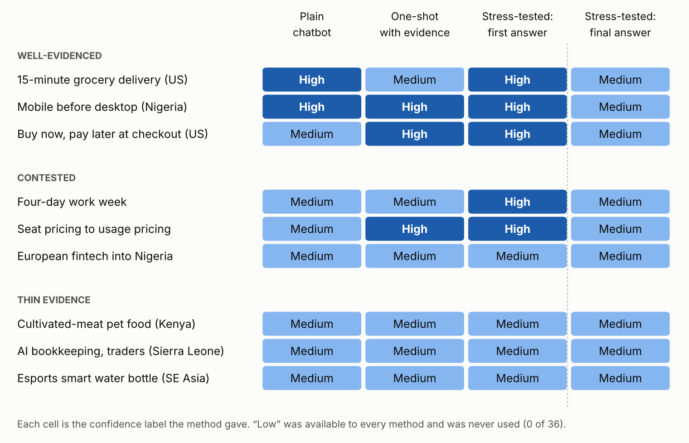

# Vet

**A study of whether an AI gives more honest advice when it has to argue against its own answer first.**

**Read the report: [`report/Vet-report.pdf`](report/Vet-report.pdf)** · **Judging this entry? Start with [`JUDGES.md`](JUDGES.md)**

People now ask AI systems what to do: launch this product, enter that market, change this policy. The answer usually arrives as a tidy brief with a recommendation and a confidence level. The danger is not that the brief is always wrong. It is that the brief can sound equally sure whether the evidence behind it is strong, mixed or almost absent, so the reader cannot tell a well-supported recommendation from a guess.

One popular fix is to make the AI stress-test itself: form an answer, look for what would prove it wrong, and only then write the brief. It is an appealing idea, and the output looks rigorous because it is full of doubts and counter-arguments. Vet asks a narrower question about it: **does that extra step change what the reader can learn from the brief, or only how careful it sounds?**

This is an entry for the [Apart Research AI x Epistemics sprint](https://apartresearch.com/sprints/ai-x-epistemics-research-sprint-2026-11-13-to-2026-11-15) (13 to 15 November 2026), Track 3: Epistemic Products.

## The short version

- **Stress-tested briefs read as more honest.** Two scorers, working without knowing which method wrote which brief, both rated them highest.
- **But the stress test never lost.** In 49 runs out of 49 it judged the AI's first answer "weakened", and confidence never went up.
- **With the main model, every final answer came out at "medium" confidence**, 40 runs out of 40, even on a question with an obvious answer. Before the stress test, the same system's confidence had followed the evidence.
- **The scoring rubric rewarded this.** Briefs that said "medium" got much higher marks for honest confidence than briefs that said "high", so a method that always says "medium" looks the most honest.
- **Two attempts to fix it failed.** 71 of 72 conclusions were still "medium".

In one sentence: arguing with itself made the AI's advice better worded, and made its confidence label stop telling the reader anything about the evidence.

## How the study works

### Three ways of answering the same question

The same model answers each question three ways:

| | Method | What it is |
| --- | --- | --- |
| A | **Plain** | One prompt, no web evidence. The ordinary chatbot answer. |
| B | **One-shot** | One prompt over a set of evidence gathered from the web. |
| C | **Stress-tested** | The same evidence, but the system first commits to an answer, attacks its own assumptions, re-judges each one, and then concludes. |

B and C are given exactly the same evidence, so the difference between them comes from the stress test alone. Comparing A with B shows what evidence adds by itself. The stress-tested method also records its **first answer**, before the stress test, which gives a before-and-after view inside one system.

Each brief has the same parts: an answer, a confidence label (low, medium or high) with a reason, what is still uncertain, and next steps.

### Questions chosen to differ in how much evidence exists

Nine yes-or-no business questions, three in each group:

- **Well-evidenced:** plenty of public data points one way. Example: should a consumer app in Nigeria be built for mobile before desktop?
- **Contested:** serious evidence on both sides. Example: should a software company adopt a four-day week?
- **Thin evidence:** a niche so specific that little direct evidence exists. Example: a subscription for cultivated-meat pet food in Kenya.

A method whose confidence means something should be less sure on the thin-evidence questions than on the well-evidenced ones.

### Three things are measured

1. **Does confidence follow the evidence?** Read straight from the confidence labels. Nobody's judgement is involved.
2. **Is the brief better by a fixed rubric?** Each brief is marked from 1 to 5 on honest confidence, counter-evidence, traceability, cruxes and useful next steps, plus a yes/no flag for overselling. The rubric ([`rubric.md`](rubric.md)) was committed before any brief was generated. Briefs were shuffled and given random IDs before scoring.
3. **What does the stress test do to the answer?** Counted from the saved records: its verdict, the kinds of challenge it raised, and whether each challenge cited evidence.

## What it found

### Before the stress test, confidence followed the evidence. After it, it did not.



Each question was run four times: a first run, then three repeats on the same evidence.

| Mean confidence (1 low, 2 medium, 3 high) | Well-evidenced | Contested | Thin evidence | Labels given |
| --- | --- | --- | --- | --- |
| One-shot with evidence | 2.92 | 2.42 | 2.00 | 16 high, 20 medium |
| Stress-tested: first answer | 2.92 | 2.58 | 2.00 | 18 high, 18 medium |
| Stress-tested: final answer | 2.00 | 2.00 | 2.00 | 36 medium |

The final answer was "medium" in all 36 runs. A label that never changes cannot tell a reader which briefs to rely on.

No method ever said "low". Out of 117 confidence labels, 36 were high, 81 were medium and none was low, including on the questions picked because direct evidence is scarce.

### The stress test never lost

Counting every run in the study, the stress test judged the first answer "weakened" in 49 of 49. It could also have said strengthened, survived or overturned, and it never did. Confidence fell in 27 runs, stayed the same in 22 and rose in none.

It was not making objections up. In the first run, 31 of its 68 challenges cited evidence that cuts against the answer. But 12 of the 31 assumptions it marked as weakened had no such evidence behind the challenge, even though the system is instructed to weaken an assumption only when evidence backs the challenge.

**Even an obvious question was weakened.** Asked whether a small business should keep records of its income and expenses, the research found 25 facts: 24 in support and none against. The first answer said high confidence in all four runs. After the stress test it was medium in all four.

### Stress-tested briefs still scored highest

| Method | First scorer (of 25) | Second scorer (of 25) | Flagged as overselling |
| --- | --- | --- | --- |
| Plain | 16.0 | 15.2 | 2 of 9 |
| One-shot with evidence | 21.8 | 19.8 | 1 of 9 |
| Stress-tested | 23.4 | 21.8 | 0 of 9 |

On the same question and the same evidence, the stress-tested brief beat the one-shot brief on 7 of 9 questions for the first scorer (2 ties) and 8 of 9 for the second (1 tie). Every mark the second scorer gave was within one point of the first scorer's.

### The rubric rewarded the flattening

The biggest gain for stress-tested briefs was on "honest confidence", the very thing their label had stopped measuring. The reason shows in the marks:

| Brief's confidence label | Honest-confidence mark, first scorer | Second scorer |
| --- | --- | --- |
| Medium (22 briefs) | 4.32 | 4.14 |
| High (5 briefs) | 2.60 | 1.80 |

A brief that says "medium" and lists what is missing looks honest every time, whether the evidence was plentiful or thin. A scorer reading one brief at a time cannot see that the label never changes. That only shows up across the whole set.

### A second model lost the link to evidence in a different way

The same evidence was run once through Claude Haiku 4.5. It also judged its first answer "weakened" 9 times out of 9. Its final label was not always medium (3 low, 6 medium), but it did not follow the evidence either: the thin-evidence questions ended with the highest average confidence (1.67 well-evidenced, 1.33 contested, 2.00 thin). So "always medium" belongs to the main model. Losing the link between confidence and evidence after the stress test showed up in both.

### Two fixes were tried, and both failed

Both were tested by re-running only the final step on the saved records:

- **A rule in code:** an assumption stays "weakened" only if a challenge aimed at it cites evidence against the answer.
- **An added instruction:** set confidence by how strong and direct the evidence is, use "low" when little is direct, and do not lower confidence for things the question itself leaves open.

| Version | Medium | High |
| --- | --- | --- |
| Unchanged | 18 | 0 |
| Rule in code | 18 | 0 |
| Added instruction | 17 | 1 |
| Both | 18 | 0 |

What the data does suggest is simpler: the confidence stated *before* the stress test carried the information, so a system could report that label and use the stress test for the wording. That idea was not tested here.

## What was checked

The first result came from one run per question. Everything below was added afterwards to see whether it would hold.

| Check | What it tested | Result |
| --- | --- | --- |
| Repeat runs | Is the pattern stable, or was it chance? | Same result in 36 of 36 runs |
| Evidence check | Did the "thin" questions really have thinner evidence? | Direct evidence: 40% well-evidenced, 13% contested, 3% thin |
| Control question | Does the stress test ever let an answer stand? | No: an obvious answer was weakened 4 times out of 4 |
| Second model | Is it only one model? | The verdict repeated; the exact label pattern did not |
| Second scorer | Are the rubric marks repeatable? | Same ranking, every mark within one point |
| Two fixes | Can the label be repaired at the final step? | No: 71 of 72 still medium |
| Exact tests | Could nine questions show this by chance? | First answer vs evidence group: p = 0.024; stress-tested vs one-shot rubric total: p = 0.016 |

## What is new here, and what existed before

The sprint rules ask for a clear line between new work and earlier work.

**Written before the sprint:** [Crux](https://github.com/Mhiah/crux), a research engine that forms a thesis, stress-tests it and records what changed. Crux is the system being tested. It supplies the evidence for method B and all of method C. None of its code is copied into this repository. Every run checks Crux out at one fixed commit (`359a6f4`), which is recorded in the workflows and in every result file.

**Written during the sprint, all in this repository:**

- the question set and its three evidence groups
- the harness that produces the three briefs per question
- the plain and one-shot comparison methods, which Crux does not have
- the scoring rubric
- the repeat runs, the control question, the second-model runs and the fix tests
- every recorded run, both sets of scores, the analysis and the report

## Honest by design

- **The harness refuses to run on sample data.** If an API key is missing it stops, so no placeholder output can end up in the results.
- **Every result file keeps the full record:** the evidence with its sources, every intermediate stage, and the Crux commit used.
- **The rubric was fixed first.** It was committed before the first brief was generated.
- **Planned and unplanned are kept apart.** The methods, questions, rubric and the confidence measure were set before the first run. The main finding was not predicted. The repeats, control, second model, second scorer, fixes and statistical tests were all added after seeing the first results, and the report says so.
- **Every number in the report comes from a script.** `analysis/analyze.py` and `analysis/checks.py` compute them from the saved files, and need nothing but Python.
- **The finding is unfavourable to the author's own tool.** The data is public so that anyone can check it.

## Project layout

```
README.md                    this file
JUDGES.md                    a short guide for judges: where everything is and how to check it
rubric.md                    the scoring rubric, fixed before the runs
questions.json               the questions and their evidence groups
controls.json                the obvious-answer control question

scripts/run.ts               the harness: three briefs per question
scripts/replicate.ts         repeats the reasoning on saved evidence, with no new searches
scripts/variants.ts          tests the two fixes on saved records
scripts/extra.sh             the commands the last extra run executed

results/                     one file per question: the three briefs and the full record
results/replicates/          three repeat runs per question
results/controls/            the control question and its repeats
results/variants/            the two fixes, and an unchanged baseline
results/model-*/             the same reasoning run on a second model
results/README.md            what is inside each result file

analysis/blind.py            puts the briefs under random IDs for scoring
analysis/blinded_briefs.md   the briefs exactly as the scorers saw them
analysis/scores.json         first scorer's marks
analysis/scores_second.json  second scorer's marks
analysis/key.json            which random ID is which method
analysis/analyze.py          main tables (writes summary.json)
analysis/checks.py           every other number in the report (writes checks.json)
analysis/directness_terms.json  the keyword lists used for the evidence check
analysis/figure.py           draws the figure

report/                      the report (PDF and LaTeX source) and the figure
.github/workflows/           the workflows that ran the study on GitHub
RUN, REPLICATE, EXTRA        small files whose changes start those workflows
```

## Run it yourself

### Check the numbers (no API keys needed)

Everything in the report can be recomputed from the saved runs with plain Python 3:

```bash
git clone https://github.com/Mhiah/Vet
cd Vet
python3 analysis/analyze.py    # main tables
python3 analysis/checks.py     # repeats, control, second model, second scorer, fixes, tests
python3 analysis/figure.py     # the figure (needs matplotlib)
```

### Run the study again (needs API keys)

You need Node.js 22 or newer, a [SERV Reasoning](https://docs.openserv.ai/serv-reasoning/why) key and a [Tavily](https://tavily.com) key.

```bash
git clone https://github.com/Mhiah/Vet
cd Vet
git clone https://github.com/Mhiah/crux
cd crux
git checkout 359a6f47805b97c594a59a431125730b4520e983
npm ci
export SERV_API_KEY=...
export TAVILY_API_KEY=...

npx tsx ../scripts/run.ts              # all questions (or name some: W1 T2)
npx tsx ../scripts/replicate.ts 3      # three repeats on the saved evidence
npx tsx ../scripts/variants.ts 2       # the two fixes
```

Questions that already have a result file are skipped, so an interrupted run can be resumed. One question costs 8 model calls and about 12 web searches. Repeats and fix tests make no web searches. Web results change over time, so a fresh run will gather different evidence from the saved one.

On GitHub the same runs start from the Actions tab once `SERV_API_KEY` and `TAVILY_API_KEY` are saved as repository secrets.

## Known limitations

- **Small sample.** Nine questions and one control. The repeats reuse the same evidence and model, so they show the pattern is stable for these questions, not that it holds for others.
- **Two models, one domain.** The main results use one model. The second was run once per question and behaved differently in detail. All questions are business decisions.
- **One stress-test design.** The stress test is one implementation with one set of prompts. Others may behave differently.
- **The evidence groups are the author's call.** Questions were sorted into groups by judgement before the runs. The evidence check that supports the grouping is a keyword match written afterwards.
- **Scoring is by AI only.** Both scorers are instances of one AI model, from a different family than the model that wrote the briefs. Their agreement shows the marks are repeatable, not that they are right. Plain briefs cite no evidence, so they can be recognised. There is no human check.
- **The rubric has no expert panel.** One criterion, next steps, was too easy: nearly every brief got full marks.
- **No ground truth.** The study measures whether briefs are honest about their support, not whether their recommendations turn out right. It cannot say which confidence label was the correct one.
- **Much of the analysis was added after the first results.** It is labelled as such in the report.
- **The fixes tested are only two.** Both change the final step. Changes to earlier steps might work.

## Author

Mia ([@Mhiah](https://github.com/Mhiah))

An AI assistant (Claude, Anthropic) was used to write the harness and analysis code, to score the briefs, and to help draft the report. This is stated in the report as well.
